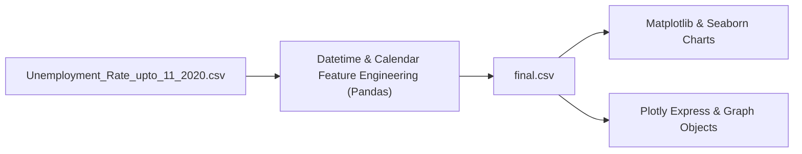

# Unemployment Data Analysis in India (`Unemployment-Data-in-India`) — Temporal & Regional EDA

An interactive Python Exploratory Data Analysis (EDA) project (`Untitled-1.ipynb`, 33 cells) analyzing state-level and temporal unemployment dynamics in India (`Unemployment_Rate_upto_11_2020.csv` -> `final.csv`) using Matplotlib, Seaborn, and Plotly.

---

## 1. Executive Summary & Purpose
`Unemployment-Data-in-India` uncovers regional disparities, seasonal fluctuations, and pandemic-era shocks in Indian labor markets through static and interactive Plotly visualizations.

## 2. Pipeline Architecture & Layers


| Layer | Tools & Artifacts |
| :--- | :--- |
| **Data Processing & Time Features** | `pandas`, `numpy`, `datetime`, `calendar` |
| **Static Statistical Visuals** | `matplotlib.pyplot`, `seaborn` |
| **Interactive Dashboards** | `plotly.express`, `plotly.graph_objects` |

## 3. Getting Started
```bash
git clone https://github.com/islamsamyy/Unemployment-Data-in-India.git
cd Unemployment-Data-in-India
jupyter notebook Untitled-1.ipynb
```

## 4. Business Value & Growth Opportunities
- **Macroeconomic & Workforce Intelligence**: Helps staffing platforms, edtech marketplaces (e.g., `faireer-academy`), and policymakers pinpoint regions with high labor supply or acute skill gaps.
- **Live Policy Dashboard**: Wrap the Plotly charts in Streamlit or Dash connected to updated labor-bureau APIs for continuous workforce monitoring.
