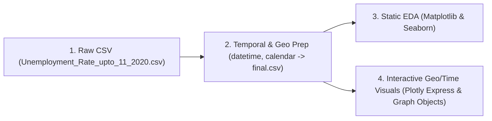

# Unemployment Data Analysis in India (`Unemployment-Data-in-India`) — Temporal & Geospatial EDA

## Table of Contents
- [Executive Summary & Business Utility](#executive-summary--business-utility)
- [Visual Showcase (UI & Dashboards)](#visual-showcase-ui--dashboards)
- [System Architecture & Layers](#system-architecture--layers)
- [Data Model & Dataset Schema](#data-model--dataset-schema)
- [Analytical Modules](#analytical-modules)
- [Getting Started](#getting-started)
- [Business Value, ROI & Growth Opportunities](#business-value-roi--growth-opportunities)

---

## Executive Summary & Business Utility
`Unemployment-Data-in-India` is a 33-cell Python Exploratory Data Analysis (EDA) project (`Untitled-1.ipynb`) examining state-by-state and month-by-month labor market dynamics across India (`Unemployment_Rate_upto_11_2020.csv` -> `final.csv`). Using Pandas, Matplotlib, Seaborn, and interactive Plotly charts (`plotly.express` & `plotly.graph_objects`), it visualizes regional shocks, labor participation shifts, and geospatial hotspots.

---

## Visual Showcase (UI & Dashboards)
Statistical & temporal visualizations extracted from `Untitled-1.ipynb`:

| Distribution & Trend Analysis | Regional Comparison | Temporal Shock View |
| :---: | :---: | :---: |
|  |  |  |

---

## System Architecture & Layers


| Layer | Tools & Artifacts |
| :--- | :--- |
| **Ingestion & Feature Engineering** | `pandas`, `numpy`, `datetime`, `calendar` (`final.csv`) |
| **Static Statistical Plots** | `matplotlib.pyplot`, `seaborn` |
| **Interactive Visuals** | `plotly.express`, `plotly.graph_objects` (geospatial `longitude`/`latitude` + monthly trends) |

---

## Data Model & Dataset Schema
- **Source & Output**: `Unemployment_Rate_upto_11_2020.csv` -> `final.csv` (**267 records**)
- **Columns**: `state`, `date`, `frequency`, `estimated unemployment rate`, `estimated employed`, `estimated labour participation rate`, `region`, `longitude`, `latitude`, `Month_int`, `Month_name`

---

## Analytical Modules
- **Data Cleaning & Calendar Extraction**: Normalizes column names, parses dates, and extracts `Month_int` and `Month_name`.
- **State & Regional Heatmaps**: Compares unemployment rates and labor participation across Indian regions and coordinates.

---

## Getting Started
```bash
git clone https://github.com/islamsamyy/Unemployment-Data-in-India.git
cd Unemployment-Data-in-India
jupyter notebook Untitled-1.ipynb
```

---

## Business Value, ROI & Growth Opportunities
- **Workforce & EdTech Market Sizing**: Helps hiring marketplaces (`bidjobsup`) and online academies (`fairer-academy`) target high-unemployment states with localized upskilling and remote-work campaigns.
- **Interactive Public Data App**: Wrap the Plotly figures in Streamlit/Dash connected to live labor-force feeds for ongoing macroeconomic intelligence.
